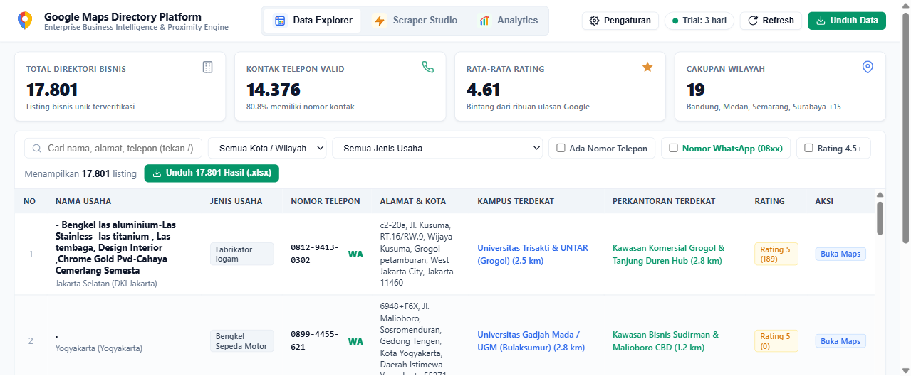
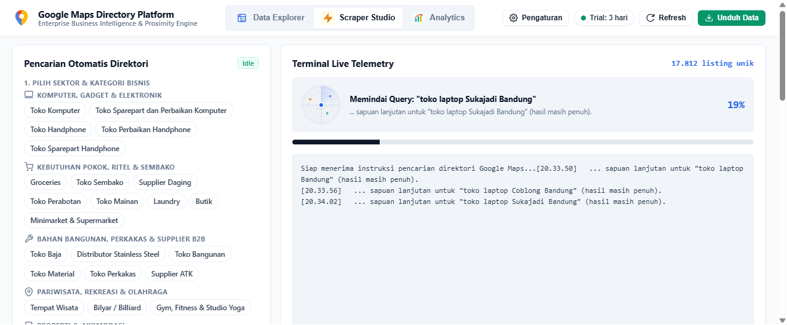
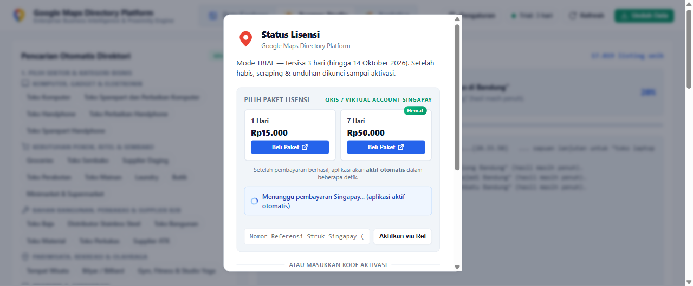

<div align="center">

  

  # GMST Scraper — Google Maps Scraper Studio
  ### Enterprise Business Intelligence, Proximity Analysis & Leads Scraper Indonesia

  [](https://github.com/99apps-id/gmaps-scraper-studio/releases/latest)
  [](https://github.com/99apps-id/gmaps-scraper-studio/releases/latest)
  [](https://github.com/99apps-id/gmaps-scraper-studio)
  [](https://singapay.id)

  <p align="center">
    Platform desktop intelijen direktori bisnis Google Maps Indonesia dengan antarmuka modern editorial, integrasi radius kampus & perkantoran terdekat, direct WhatsApp follow-up, serta ekspor multi-format (Excel/CSV/JSON).
  </p>

  [📥 Unduh Installer (.exe)](#-unduh-aplikasi-desktop) •
  [✨ Fitur Utama](#-fitur-utama) •
  [📸 Screenshot](#-antarmuka-aplikasi) •
  [💳 Lisensi & Singapay](#-lisensi--pembayaran-singapay) •
  [🚀 Cara Menjalankan](#-cara-menjalankan-development)

</div>

---

## 📸 Antarmuka Aplikasi

### 1. Data Explorer & Leads Management
Jelajahi puluhan ribu listing bisnis lengkap dengan kontak WhatsApp, rating ulasan, koordinat, dan filter instan.
<p align="center">
  
</p>

### 2. Scraper Studio & Telemetri Realtime
Pilih dari 40+ kategori bisnis, target wilayah seluruh pulau Indonesia, dan monitor proses scraping secara live via Server-Sent Events (SSE).
<p align="center">
  
</p>

### 3. Modal Lisensi & Integrasi Singapay
Sistem aktivasi otomatis terintegrasi dengan Payment Gateway Singapay (QRIS & Virtual Account) untuk paket harian dan mingguan.
<p align="center">
  
</p>

---

## ✨ Fitur Utama

- 🎯 **One-Click WhatsApp Follow-up**: Klik langsung membuka obrolan WhatsApp (`https://wa.me/62...`) tanpa perlu menyimpan nomor telepon ke kontak terlebih dahulu.
- 📱 **Filter Cepat WhatsApp (08xx)**: Memisahkan secara instan antara nomor telepon kantor/tetap dan nomor ponsel yang terhubung ke WhatsApp.
- 🏫 **Proximity & Distance Engine (Haversine)**: Mengkalkulasi otomatis kampus/universitas dan kawasan perkantoran/CBD terdekat beserta estimasi jarak dalam kilometer.
- 🏢 **40+ Sektor Bisnis Bernilai Tinggi**:
  - **Legal & B2B**: Notaris & PPAT, Konsultan Pajak & KAP, Kantor Hukum / Advokat.
  - **Kecantikan & Gaya Hidup**: Klinik Estetika, Salon Kecantikan & Spa Reflexology, Barbershop.
  - **Wedding & Acara**: Wedding & Event Organizer, Studio Foto.
  - **Properti & Hunian**: Kost (Putra, Putri, Pasutri, Bebas), Kontrakan, Apartemen, Hotel, Guest House.
  - **Kuliner & F&B**: Coffee Shop, Restoran Padang, Bakery, Seafood, Katering.
  - **Kesehatan & Otomotif**: Apotek 24 Jam, Klinik Gigi, Laboratorium Medis, Bengkel Mobil/Motor, Car Wash.
- 🗺️ **Cakupan Seluruh Indonesia**: Jabodetabek, Jawa Barat, Jawa Tengah & DIY, Jawa Timur, Bali & Nusa Tenggara, Sumatera, Kalimantan, dan Sulawesi.
- 📊 **Multi-Format Export**: Ekspor data terformat rapi ke Microsoft Excel (.xlsx multi-sheet), CSV (UTF-8 BOM), dan JSON.
- 🔔 **Audio & Desktop Telemetry**: Denting audio halus berbasis Web Audio API ketika proses scraping selesai.

---

## 📥 Unduh Aplikasi Desktop

Installer resmi versi **v0.1.0** untuk Windows siap diunduh:

| Platform | Format | Tautan Download |
| :--- | :--- | :--- |
| **Windows** | `.exe` (NSIS Installer) | [**Download GMST Scraper Setup 0.1.0.exe**](https://github.com/99apps-id/gmaps-scraper-studio/releases/latest) |
| **macOS** | `.dmg` / `.zip` | *Segera hadir di release berikutnya* |
| **Linux** | `.AppImage` / `.deb` | *Segera hadir di release berikutnya* |

---

## 💳 Lisensi & Pembayaran Singapay

Aplikasi ini dilengkapi dengan masa percobaan gratis (**Trial 3 Hari**) sejak pertama kali diinstal:
- **Paket Harian (1 Hari)**: Rp 15.000 — Cocok untuk kebutuhan penarikan prospek harian.
- **Paket Mingguan (7 Hari)**: Rp 50.000 — Pilihan paling hemat untuk agensi dan tim sales.

> **Aktivasi Instan Otomatis**: Setelah Anda menyelesaikan pembayaran melalui QRIS/VA Singapay, aplikasi akan mendeteksi status transaksi secara otomatis tanpa perlu mengetik ulang kode aktivasi.

---

## 🚀 Cara Menjalankan (Development)

Untuk kontributor atau developer yang ingin menjalankan proyek dari source code:

```bash
# Clone repository
git clone https://github.com/99apps-id/gmaps-scraper-studio.git
cd gmaps-scraper-studio

# Install dependensi
npm install

# Jalankan Web Dashboard lokal
npm run dashboard

# Jalankan Aplikasi Desktop Electron
npm run electron
```

### Build Installer Mandiri

```bash
# Windows
npm run dist:win

# macOS
npm run dist:mac

# Linux
npm run dist:linux
```

---

<div align="center">
  <p>Dikembangkan oleh <b><a href="https://99apps.id">99apps.id</a></b> • Hak Cipta dilindungi Undang-Undang</p>
  <p>Butuh bantuan teknis atau kemitraan lisensi? Hubungi <b>support@99apps.id</b></p>
</div>
